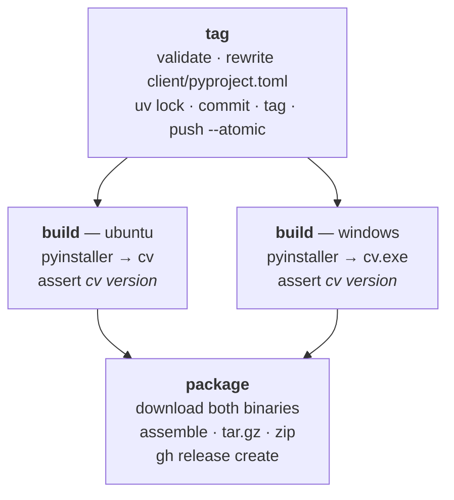

# Cutting a release

The client has its own version, independent of the server's: a client talks to
any server that speaks protocol 2, so the two are released apart. One thing you
type: Actions → **Release** → *Run workflow* → `1.2.0` → *Run*. Nothing
happens on your machine.

`.github/workflows/release.yml` writes that number into `client/pyproject.toml`
and `uv.lock`, commits it, tags `v1.2.0`, builds both binaries from that tag
and publishes them as `.tar.gz` and `.zip` archives on the release page.

The server image and the doc site are released from
[ats-strike](https://github.com/gcontini/ats-strike), by its own Release
workflow.

## Before the first one

Nothing to set up: the workflow needs no secret. It declares
`permissions: contents: write` because the repository default for
`GITHUB_TOKEN` is read-only, and this workflow pushes a commit, a tag and a
release; without that block the push is refused with a 403.

## Running it

Type the number bare: `1.2.0`, not `v1.2.0`. The tag gets the `v`.

It refuses, before writing anything, when:

| Refusal | Why |
|---|---|
| the version is not `MAJOR.MINOR.PATCH` | the tag and the archive name are built from it |
| you dispatched from a branch other than `main` | a release that is not on the main line is a release nobody can reconstruct |
| `v<version>` is already on the remote | re-releasing a version silently is how two different binaries end up with one number |

## What happens



**The tag is pushed first, before anything is built.** The binaries have to
carry the version, so the bump has to precede the build, and the build jobs
can only check out a commit that exists on the remote.

## Where the version lives

There is no `__version__` string in the source to forget to bump:

| Where | Who writes it |
|---|---|
| `client/pyproject.toml` | the workflow, with `sed` |
| `uv.lock` | `uv lock`, in the same commit |
| `cv version`, and every `--verbose` run | `importlib.metadata.version("ats-strike-client")` |

`contracts/` is not: it is the ats-strike-contract submodule and keeps its own
version there. A release ships whatever commit the submodule points at.

What guards the version in the binaries is the assertion: both build jobs run
`cv version` on the binary they just produced, before anything is published.

## What gets published

The release page carries `ats-strike-client-x.y.z.tar.gz` and
`ats-strike-client-x.y.z.zip`, the same files in both. The archive is a data
folder, ready to run:

```text
cv                           the Linux executable, already +x
cv.exe                       the Windows executable
README.md                    the client README, links rewritten for this layout
cv.toml                      [servers.v11]: folder v11, http://localhost:8080; edit it
posting.txt                  something to try it on
v11/                         a server folder
  candidate_profile.json     the fictional set, ready to edit
  candidate_data.json
  candidate_preferences.md
  candidate_signature.png
```

`cv.toml`'s `[servers.v11]` section names `v11/` and the server the client
sends that folder's files to, so the archive works as soon as it is extracted
and `url` points at your server:

```bash
mkdir ats-strike && tar xzf ats-strike-client-1.2.0.tar.gz -C ats-strike
cd ats-strike
$EDITOR cv.toml              # url, and token if the server wants one
./cv submit-raw posting.txt
```

Extract it into a folder of its own, as above: it unpacks five files and a
folder wherever you stand.

## When it fails

| What failed | What is left behind | What to do |
|---|---|---|
| `tag` | nothing — the branch and the tag are pushed with `--atomic`, so they land together or not at all | fix it and dispatch again |
| a later job, transiently — a runner flake | the bump commit and the tag, no release | **Re-run failed jobs**. `tag` is skipped and its `sha` output carries over, so the re-run builds the same commit. |
| a later job, for a real reason — the Windows build broke | the same | the release was never valid. Fix it on `main` and release the next patch number. |

**The release commit does not run CI.** Pushes made with `GITHUB_TOKEN` do not
trigger further workflow runs, so: **release only from a green `main`.**
